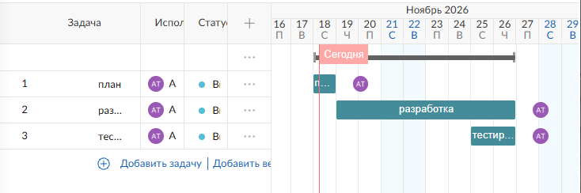

# Техническое задание на программу «Планировщик задач»

### Как это должно выглядеть

* **Главное окно**: Окно должно называться «Планировщик задач». По размеру сделайте его не слишком большим, примерно как на картинке (например, 400 на 500). По возможности, вставьте какую-нибудь красивую иконку наверх.
* **Картинка**: В самом верху окна нужна картинка по теме (что-то вроде планирования или учебы). Ее надо загрузить через код и вставить в рамку.
* **Поля для ввода**: Ниже картинки нужны две строчки, куда пользователь будет писать текст:
  * Первая строчка — для названия самой задачи.
  * Вторая строчка — для количества дней (сколько займет выполнение). Пожалуйста, подпишите их сверху, чтобы было понятно, куда что писать.
* **Кнопки**: Еще ниже нужны две кнопки рядом друг с другом:
  * Кнопка «Добавить задачу» (сделайте ее зеленой).
  * Кнопка «Очистить поля».
* **Счетчик**: В самом низу окна должна быть надпись «Задач добавлено: 0».

---

### Как это должно работать (что происходит при нажатии)

1. **Если нажать «Добавить задачу»**:
   * Программа должна запомнить то, что написано в полях.
   * Счетчик внизу должен увеличиться (было 0 — стало 1, потом 2 и так далее).
2. **Если нажать «Очистить поля»**:
   * Текст из обеих строчек ввода должен полностью стереться, чтобы можно было сразу писать новую задачу. Счетчик при этом трогать не нужно.

---

### Технические подсказки (из таблицы)

* Окно делаем через стандартный `Tk()`, имя задаем через `title()`, а размер — через `geometry()`.
* Картинку выводим с помощью `PhotoImage` и засовываем в `Label`.
* Строчки для ввода — это элементы `Entry`. Чтобы забирать из них текст, используем `.get()`, а чтобы стирать — `.delete(0, END)`.
* Для зеленой кнопки привязываем функцию через `command=`.
* Текст счетчика внизу меняем через `label["text"] = ...` или `.config()`.

